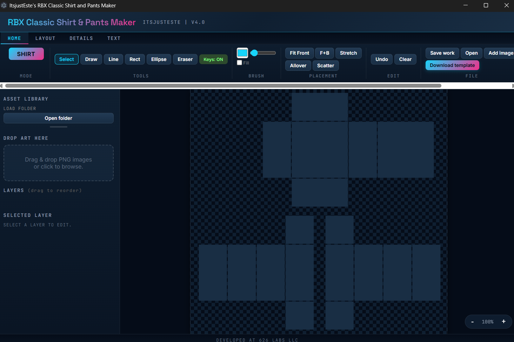
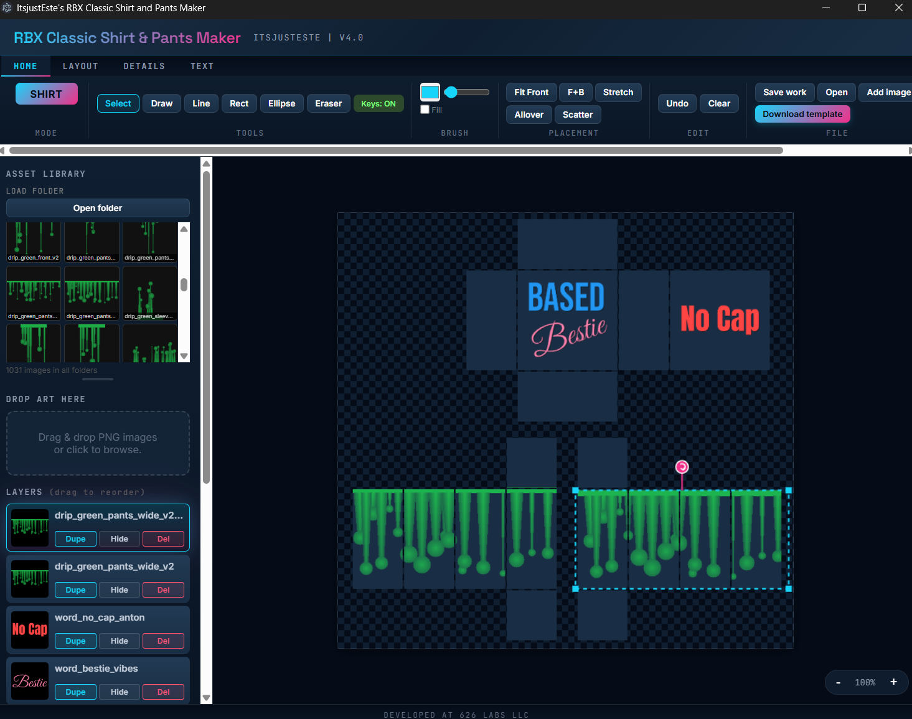
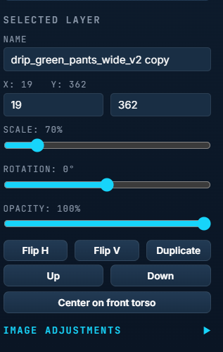
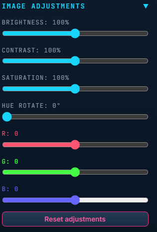
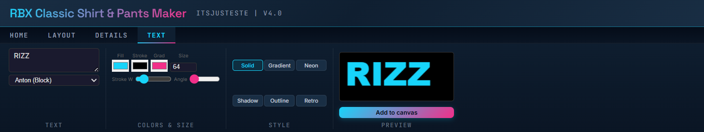
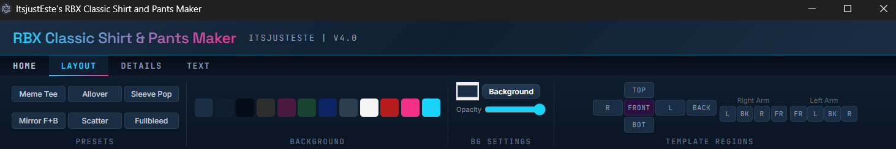
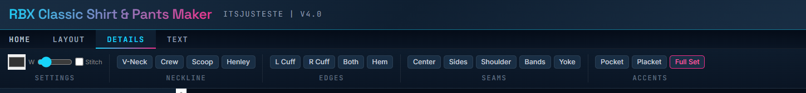

<h1 align="center">RBX15 Classic Shirt and Pants Maker</h1>

<p align="center"><em>Imagine Something Else.</em></p>

<p align="center">
A native Windows editor for Roblox Classic (R15) shirt and pants templates.
Layers, non-destructive image adjustments, Word Art, drawing tools, and a large canvas
that fills the window, built for the exact 585×559 template grid.
</p>

<p align="center">
  <a href="https://github.com/estevanhernandez-stack-ed/RBX15-Shirt-and-Pants/releases"></a>
  <a href="https://github.com/estevanhernandez-stack-ed/RBX15-Shirt-and-Pants/actions/workflows/dotnet-ci.yml"></a>
  <a href="https://github.com/estevanhernandez-stack-ed/RBX15-Shirt-and-Pants/stargazers"></a>
  <a href="LICENSE"></a>
  
</p>

<p align="center">
  <strong>Windows 10 (1809) / 11, 64-bit</strong> · <strong>WPF on .NET 10</strong> · <strong>v5.0.0</strong>
</p>

<p align="center">
<sub>Independent third-party tool. Not affiliated with Roblox Corporation. Roblox is a trademark of Roblox Corporation, used nominatively to describe the output format.</sub>
</p>

<!-- D3: item 16 swaps this and the Quick tour images for v5 captures from docs/screenshots/5.0/ (Home, Background, Details, Text, a finished shirt). -->
<p align="center">
  
</p>

---

## Install

### Microsoft Store

Get it from the Store: [RBX15 Classic Shirt and Pants Maker](https://apps.microsoft.com/detail/9MV9G4XFJ8S0). The Store version installs and updates itself, and it registers `.r15proj` files so Explorer opens them in RBX15.

### Portable zip

Download `RBX15-Maker-v5.0.0-portable-win-x64.zip` from [Releases](https://github.com/estevanhernandez-stack-ed/RBX15-Shirt-and-Pants/releases), extract it anywhere, and run `RBX15.App.exe`. The app carries its own .NET runtime, so there is nothing else to install. The zip is not code-signed, so Windows SmartScreen may ask you to confirm the first launch.

### Quit RBX15 before updating

Save your work and quit RBX15 before you update it. For the Store version, close the app before the update installs. For the zip, extract the new version into a fresh folder rather than over the old one, because Windows locks the files of a running app.

### Build from source

You need the [.NET 10 SDK](https://dotnet.microsoft.com/download) (`global.json` pins the feature band) on Windows.

```bash
git clone https://github.com/estevanhernandez-stack-ed/RBX15-Shirt-and-Pants.git
cd RBX15-Shirt-and-Pants
dotnet build src/RBX15.slnx -c Release
dotnet test src/RBX15.slnx -c Release --no-build
dotnet run --project src/RBX15.App
```

To build the MSIX and the portable zip, run `scripts/build-msix.ps1` (it needs the Windows SDK for `makeappx`). Output lands in `dist/`. The test count is not written down here, because it changes with every commit: see the latest run of [.NET CI](https://github.com/estevanhernandez-stack-ed/RBX15-Shirt-and-Pants/actions/workflows/dotnet-ci.yml).

---

## A quick tour

<!-- D3: these images are the 4.1 look until item 16 captures v5. -->
<table>
  <tr>
    <td align="center" width="50%"><br><strong>Layers panel</strong><br><sub>large thumbnails, Dupe, Hide and Del buttons</sub></td>
    <td align="center" width="50%"><br><strong>Image adjustments</strong><br><sub>brightness, contrast, saturation, hue, live</sub></td>
  </tr>
  <tr>
    <td align="center" width="50%"><br><strong>Per-channel RGB shift</strong><br><sub>tint a layer without touching the source image</sub></td>
    <td align="center" width="50%"><br><strong>Word Art</strong><br><sub>15 fonts, six styles, live preview</sub></td>
  </tr>
  <tr>
    <td align="center" width="50%"><br><strong>Background tab</strong><br><sub>presets, backgrounds, fill styles, template regions</sub></td>
    <td align="center" width="50%"><br><strong>Details tab</strong><br><sub>collars, cuffs, hems, seams, pockets, plackets</sub></td>
  </tr>
</table>

---

## Features

### Compositing

- **Layers.** Drag a row to reorder it, or press Alt+Up and Alt+Down on a focused row. Dupe, Hide (or Show) and Del sit on every row. The Selected layer panel sets name, position, scale, rotation, opacity and flips. Each layer keeps its own adjustments.
- **On-canvas transform.** Move, scale and rotate with the corner handles and the rotation handle. The mouse wheel scales the selected layer with the Select tool and changes the brush size with a drawing tool. Zoom runs from 25% to 300%.
- **Asset library.** Load the bundled Drips pack (156 images) or Word art pack (25), or open any folder. Click a thumbnail to add it fit to 85% of the front slot. Drag it onto the canvas to drop it where you want it, or right-click it for full-template scale.
- **Your own images.** Drop PNG, JPG, GIF, WEBP or BMP files onto the canvas or the drop zone, use Add image, or paste with Ctrl+V. Each image can be up to 100 MiB, 16384 pixels on a side and 50 megapixels.
- **Word Art.** 15 fonts, six styles (solid, gradient, neon, shadow, outline, retro), live preview, stroke width and gradient angle. Text breaks only where you press Enter. Add to canvas places the result at 85% of the front slot's fit whatever the Size box says, so Size changes the stroke-to-letter proportions, not the placed size.
- **Drawing tools.** Pen, line, rectangle, ellipse and eraser, with brush color, size and fill. A stroke becomes a new layer cropped to its bounds. The eraser works on the selected layer.

### Adjustments

- **Non-destructive.** Brightness, contrast, saturation and hue rotate, plus a red, green and blue shift per channel. Every slider updates the canvas as you drag.
- **Reset adjustments** puts every slider back without touching the source image.
- **Baked on export.** Download template applies the adjustments, so the PNG matches the canvas.

### Roblox-specific

- **Exact R15 grid.** A 585×559 canvas with the torso, arm, leg and waist regions. The Mask and Grid boxes show what will land on the avatar.
- **Shirt and Pants.** The Mode button switches the template. Switching mode clears the region fills and keeps your layers.
- **Placement.** Fit Front, F+B, Stretch, Allover and Scatter place the selected layer, and the Selected layer panel adds Center on front torso. The Background tab adds six presets while a layer is selected: Meme Tee, Allover, Sleeve Pop, Mirror F+B, Scatter and Fullbleed.
- **Clothing details.** V-neck, crew, scoop and henley collars; left, right and both cuffs; hem; center and side seams; shoulder stripe, arm bands and yoke; chest pocket and button placket; and a full set. Pick a color and a width from 1 to 8, with an optional stitched look. Each detail becomes a layer.
- **Region fills.** Pick a Fill Style (solid, linear gradient, radial gradient, stripes, checker, dots or camo), then click a region tile to paint it. With a layer selected, a click fits that layer into the region instead. Right-click a tile to clear it. Patterns tile across connecting faces and a gradient spans a connected group, so a design wraps the body as one piece.
- **3D preview.** A panel on the right shows your template on a Classic or R15 avatar and follows every edit. Drag to turn it, double-click to face front. It turns slowly when idle. Switch it off with the 3D preview box, and bring it back from the 3D tab at the canvas edge.

### Workflow

- **Save work** writes a `.r15proj` file. Open it later with layers, adjustments, positions and region fills intact. Save As is Ctrl+Shift+S.
- **Download template** exports a 585×559 PNG ready to upload to Roblox.
- **Undo covers every edit.** Each change to the document is one undo step: layers, transforms, adjustments, region fills, the background and the mode. History holds 30 steps, with Redo on Ctrl+Y and Ctrl+Shift+Z.
- **Window.** It opens at 1200×800, centered, and remembers its size and position. The minimum is 640×480. The title shows `*` while there are unsaved changes, and closing asks whether to save.

### Autosave, recent projects and paste

- **Autosave and crash recovery.** While a document has unsaved changes, the app writes a copy to its own data folder every 60 seconds. It never writes over your file. If RBX15 crashes or is ended from Task Manager, the next launch asks whether to restore that work. Restore opens it as unsaved (`*` in the title), and Ctrl+S then saves to the original path when the file still exists. Discard deletes the copy, and closing the prompt keeps it for the next launch. A save, an open or a normal close removes the copy.
- **Recent projects.** The Recent button beside Open lists your last 10 projects, newest first, with the full path as a tooltip. Files that no longer exist drop off the list, and Clear recent list empties it. The same 10 appear on the taskbar jump list under Recent.
- **Open from Explorer.** Double-click a `.r15proj` file to open it in RBX15. Every launch is its own window, so opening a second project from Explorer or the jump list gives you a second window. Ctrl+O inside a window replaces that window's document, after the save prompt. The Store package registers the file type. With the zip, use Open with and choose `RBX15.App.exe`.
- **Paste as a layer.** Ctrl+V adds the clipboard image as a new layer on top, selected, fit to the front slot, as one undo step. It reads a PNG first (transparency kept), then image files copied in Explorer, then a plain bitmap. With nothing usable on the clipboard the status strip says so. A focused text box keeps Ctrl+V for text.
- **Error log.** An unexpected error is written to `%LOCALAPPDATA%\RBX15\logs\error.log`. The log holds no document content and is never sent anywhere.

### Privacy and control

- **No network.** The app makes no network requests. No telemetry, no analytics, no ads, no account. The fonts are bundled, so Word Art and the interface look the same offline. [Privacy policy](docs/PRIVACY.md) lists everything the app stores and where.
- **Fonts.** The app bundles 18 font families. Seventeen are under the SIL Open Font License 1.1, and Permanent Marker is under the Apache License 2.0. Each license ships in `assets/fonts/<family>/`.
- **Your files stay where you put them.** Projects and exports save where you choose, and images load from your disk.

---

## Controls

Mouse:

| Action | Effect |
| --- | --- |
| Click an asset thumbnail | Add it as a layer, fit to 85% of the front slot |
| Drag an asset thumbnail onto the canvas | Add it at the drop position |
| Right-click an asset thumbnail | Add it at full-template scale |
| Drop image files on the canvas or the drop zone | Add them as layers |
| Wheel (Select tool) | Scale the selected layer |
| Wheel (a drawing tool) | Change the brush size |
| Click a region tile | Paint it with the current Fill Style (or fit the selected layer into it) |
| Right-click a region tile | Clear it |
| Drag a layer row | Reorder layers |

Keyboard. The Keys button in the Tools group turns the bare keys on and off (`Keys: ON` at every launch). The Ctrl chords always work. A focused text box keeps every key.

| Key | Effect |
| --- | --- |
| `Ctrl+Z` | Undo |
| `Ctrl+Y` or `Ctrl+Shift+Z` | Redo |
| `Ctrl+D` | Duplicate the selected layer |
| `Ctrl+O` | Open a project |
| `Ctrl+S` | Save work |
| `Ctrl+Shift+S` | Save As |
| `Ctrl+V` | Paste an image as a new layer |
| `V` `B` `L` `U` `O` `E` | Select, Pen, Line, Rect, Ellipse, Eraser (press the active tool's key again to return to Select) |
| Arrow keys | Nudge the selected layer 1 pixel (Shift: 10) |
| `[` and `]` | Rotate 5° counter-clockwise or clockwise (Shift: 15°) |
| `R` | Reset rotation |
| `+` and `-` | Scale the selected layer up or down |
| `Delete` or `Backspace` | Remove the selected layer |

`ShellTests` pins the Ctrl chords and `ShortcutRouterTests` pins the rest.

---

## Docs

- [Changelog](CHANGELOG.md)
- [Contributing](CONTRIBUTING.md)
- [Security policy](SECURITY.md)
- [Privacy policy](docs/PRIVACY.md)
- [Smoke test](docs/SMOKE_TEST.md) · [Windows release test plan](windows/TEST_PLAN.md)
- [Port ledger](docs/port/README.md): every 4.1 behavior and how v5 treats it

---

## Known limitations

- High-contrast themes are not supported. The app draws its own dark palette whatever Windows theme is set.
- Screen readers read the controls, but edits made on the canvas (moving, painting, filling) are not announced.
- The portable zip is unsigned.

---

## Legacy 4.1 source

<!-- Legacy 4.1 -->
The Electron app that shipped as 4.1 (`main.js`, `editor.html`, `editor.js`, `styles.css`, `lib/`, `package.json`) still sits in the repo root. v5 does not use it. It stays until the cutover removes it, as the reference the parity ledger and the frozen render goldens in `tests/goldens/` were taken from. Don't build on it. To run it you need Node.js 18+, then `npm install` and `npm start`.

---

## Why "RBX Classic"?

Roblox has two avatar systems: **Classic** (the flat-panel shirts and pants uploaded as PNGs) and **Layered Clothing** (3D mesh garments). This tool builds templates for the former: the 585×559 R15 mapping that ships with every Roblox account and still dominates marketplace listings.

---

## License

MIT. Built by [626Labs](https://626labs.dev).

Part of the 626Labs product family. Find other tools at [626labs.dev](https://626labs.dev).

<p align="center">
  <sub>
    "Roblox" and the Roblox logo are trademarks of Roblox Corporation, used nominatively to describe the output file format. RBX15 Classic Shirt and Pants Maker is an independent third-party tool.
  </sub>
</p>
